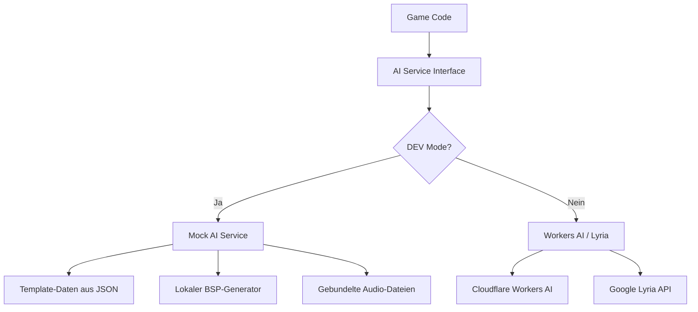

# Dungeon Crawl -- Technischer Plan & Strategie

> Ein mobile-first Dungeon Crawl Spiel im klassischen First-Person-Rasterbewegung-Stil
> mit Pixel-Art-Grafik, tiefer KI-Integration und adaptiver Musik.

---

## Inhaltsverzeichnis

1. [Spielkonzept](#1-spielkonzept)
2. [Technischer Stack](#2-technischer-stack-phaser-3--nextjs-15--cloudflare)
3. [Architektur im Detail](#3-architektur-im-detail)
4. [Implementierungs-Leitfaden](#4-implementierungs-leitfaden)
5. [KI-Integration](#5-ki-integration)
6. [Offline-Modus & Cache-Strategie](#6-offline-modus--cache-strategie)
7. [Mobile Steuerung](#7-mobile-steuerung)
8. [Pixel-Art-Grafik-Pipeline](#8-pixel-art-grafik-pipeline)
9. [Viralitaet & Vermarktung](#9-viralitaet--vermarktung)
10. [Monetarisierung](#10-monetarisierung)
11. [Marktchancen](#11-marktchancen)
12. [Mehrsprachigkeit](#12-mehrsprachigkeit)
13. [Testing-Strategie](#13-testing-strategie)
14. [Deployment & DevOps](#14-deployment--devops)

---

## 1. Spielkonzept

### Genre-Definition

Klassischer First-Person-Dungeon-Crawler mit Echtzeit-Kampf auf Rasterbasis. Der Spieler steuert eine Gruppe von bis zu vier Abenteurern durch prozedural generierte Verliese. Die Perspektive ist Ego-Sicht mit Pseudo-3D durch geschichtete 2D-Sprites (keine echte 3D-Engine).

### Kern-Spielmechaniken

- **Rasterbewegung**: Schrittweise Fortbewegung auf einem quadratischen Gitter, 90-Grad-Drehungen
- **Echtzeit-Kampf**: Aktionsbasiert mit individuellen Abklingzeiten pro Charakter und Aktion
- **Runen-Magiesystem**: Zaubersprueche werden aus Runen-Kombinationen zusammengesetzt (nicht vorgefertigt)
- **Ressourcen-Management**: Lebenspunkte, Mana, Ausdauer, Saettigung, Durst
- **Inventar**: Drag-and-Drop, koerperteilspezifische Ausruestungsslots
- **Exploration**: Fallen, Geheimtueren, Raetsel, verschlossene Bereiche
- **Charakter-Progression**: Vier Pfade (Krieger, Schurke, Magier, Priester), Training durch Nutzung

### Einzigartige Merkmale (USP)

- **KI-Dungeon-Master**: Ein LLM erzaehlt die Geschichte dynamisch und reagiert auf Spielerentscheidungen
- **Prozedurale Welten**: Jeder Durchlauf bietet ein neues, KI-generiertes Verlies
- **Adaptive Schwierigkeit**: Das Spiel passt sich dem individuellen Spielerniveau an
- **KI-Soundtrack**: Kontextbezogene, KI-generierte Musik die auf den Spielzustand reagiert
- **Runen-Gesten**: Zaubersprueche durch Wisch-Gesten auf dem Touchscreen wirken
- **Offline spielbar**: Aggressive Vorausgenerierung und Cache ermoeglichen volles Spielerlebnis ohne Verbindung

---

## 2. Technischer Stack: Phaser 3 + Next.js 15 + Cloudflare

### Warum dieser Stack?

| Komponente | Technologie | Begruendung |
|---|---|---|
| Game Engine | **Phaser 3.90+** | Fuehrendes HTML5-Game-Framework, <200KB Build, 60fps mobil, eingebautes Scene-Management, Sprite-System, Touch-Input, Sound |
| App Shell | **Next.js 15 (App Router)** | SSR fuer Landing Pages, API Routes fuer KI-Backend, PWA-Support. Auf Cloudflare via `@opennextjs/cloudflare` Adapter |
| Sprache | **TypeScript 5** | Typsicherheit fuer komplexe Spiellogik, bessere IDE-Unterstuetzung |
| Styling | **Tailwind CSS 4** | Utility-first fuer UI-Komponenten ausserhalb des Spiels (Menues, Einstellungen) |
| State | **Zustand** | Leichtgewichtiger State-Manager fuer React-Phaser-Kommunikation |
| i18n | **next-intl** | Mehrsprachigkeit mit Routing-Support (de/en) |
| KI (LLM) | **Cloudflare Workers AI** | Llama 3.2 (1B/3B), Mistral 7B am Edge -- 10.000 Neurons/Tag kostenlos, extrem guenstige Token-Preise |
| Musik | **Lyria API (Vertex AI)** + **Tone.js** | KI-Musik-Generierung + prozeduraler Audio-Fallback |
| Datenbank | **Cloudflare D1** | Verteilte SQLite-DB -- 5GB + 5 Mio. Queries im Free Tier. Savegames, Profile, Leaderboards |
| Cache | **Cloudflare KV** | Key-Value-Store fuer KI-Response-Cache, Session-Daten, vorab generierte Inhalte |
| Asset Storage | **Cloudflare R2** | S3-kompatibler Object Storage -- 10GB + 1 Mio. Ops im Free Tier. Fuer grosse Sprite-Atlases und Musik-Cache |
| Hosting | **Cloudflare Pages** | 300+ PoPs weltweit, unbegrenzte Bandbreite im Free Tier, Edge-Funktionen via Workers |
| Testing | **Vitest** + **Playwright** | Unit-Tests + E2E-Tests |

### Warum Cloudflare statt Vercel?

| Aspekt | Cloudflare | Vercel |
|---|---|---|
| **Bandbreite** | Unbegrenzt (Free Tier) | 100GB, danach Aufpreis |
| **Edge Performance** | 300+ PoPs, ~9s fuer Workloads die bei Vercel ~38s brauchen | Gut, aber langsamer am Edge |
| **Eingebaute KI** | Workers AI: 50+ Open-Source-Modelle (Llama, Mistral, etc.) direkt am Edge | Keine -- externes API noetig |
| **Datenbank** | D1 (SQLite, 5GB free) | Postgres (256MB free) |
| **Object Storage** | R2 (10GB free, S3-kompatibel) | Blob (begrenzt) |
| **KV Store** | Cloudflare KV (1GB free) | Vercel KV (256MB free) |
| **Kosten bei Skalierung** | Deutlich guenstiger, besonders bei hohem Traffic | Wird teuer durch Usage-Based Billing |
| **Next.js Support** | Via `@opennextjs/cloudflare` -- funktioniert, aber braucht Adapter | Nativ, Zero-Config |
| **Docker/Container** | Ja (seit 2026) | Nein |

**Fazit**: Fuer ein Spiel mit hohem Traffic-Potenzial, eingebauter KI-Anforderung und grosszuegigem Free Tier ist Cloudflare die bessere Wahl. Der Mehraufwand durch den OpenNext-Adapter ist minimal.

### Workers AI: Verfuegbare Modelle und Kosten

| Modell | Input-Preis/M Token | Output-Preis/M Token | Einsatz |
|---|---|---|---|
| **Llama 3.2 1B** | $0.027 | $0.201 | Schnelle Texte: Raumbeschreibungen, Kampfkommentare, Item-Texte |
| **Llama 3.2 3B** | $0.051 | $0.335 | Dungeon-Generierung, NPC-Dialoge, Narrative |
| **Mistral 7B** | $0.110 | $0.190 | Komplexe Narrative, Raetsel-Design, DDA-Analyse |
| **Llama 3.3 70B** | $0.293 | $2.253 | Premium: Tiefe Story-Generierung (nur bei Bedarf) |

**Kostenschaetzung**: Bei 10.000 aktiven Spielern/Monat mit ~20 KI-Aufrufen pro Session:
- ~2M Input-Tokens + ~500K Output-Tokens pro Tag
- **~$3-5/Tag** mit Llama 3.2 3B als Hauptmodell
- Verglichen mit Gemini API: Deutlich guenstiger und ohne externe Abhaengigkeit

### Phaser 3 im Detail

**Was Phaser mitbringt (und was wir nutzen):**

```
Genutzt:
  - WebGL Renderer mit Canvas-Fallback
  - Scene Manager (Szenen-Wechsel: Menue -> Spiel -> Inventar -> Kampf)
  - Sprite & Texture Atlas Support
  - Tween-Animationen (Sprite-Bewegungen, UI-Uebergaenge)
  - Input Manager (Touch, Pointer, Keyboard)
  - Sound Manager (Web Audio API)
  - Camera System (Viewport-Steuerung, Shake-Effekte)
  - Loader (Asset-Pipeline mit Fortschrittsanzeige)
  - Timer & Clock (Echtzeit-Kampf-Ticks)

Nicht genutzt (fuer dieses Projekt ueberfluessig):
  - Arcade Physics / Matter.js (Grid-basierte Bewegung braucht keine Physik-Engine)
  - Tilemap-Physik (eigene Kollisionserkennung auf Grid-Basis)
```

**Phaser-Lifecycle in unserem Spiel:**

```
Boot Scene          -> Laedt Konfiguration, prueft Browser-Faehigkeiten
Preload Scene       -> Laedt alle Assets mit Fortschrittsbalken
MainMenu Scene      -> Hauptmenue (Neues Spiel, Laden, Einstellungen)
DungeonView Scene   -> KERN: First-Person-Dungeon-Rendering
CombatOverlay Scene -> Kampf-UI (laeuft parallel zur DungeonView)
InventoryOverlay    -> Inventar/Charakter (laeuft parallel)
DialogOverlay       -> KI-DM-Texte, NPC-Dialoge
MapOverlay          -> Automap-Ansicht
```

### Next.js 15 Rolle

Next.js dient NICHT als Game-Engine, sondern als:

1. **App-Container**: Hosting der Phaser-Canvas in einer React-Komponente
2. **UI-Layer**: Menues, Einstellungen, Leaderboards, Account-Verwaltung (React-Komponenten)
3. **API-Backend**: Server-Side Routes als Proxy zu Workers AI und Lyria (Schutz der API-Keys)
4. **PWA-Shell**: Manifest, Service Worker, Offline-Faehigkeit
5. **Landing Page**: SSR-optimierte Marketingseite fuer SEO und Social Sharing
6. **Analytics**: Cloudflare Web Analytics fuer Spieler-Metriken

### Warum NICHT die Alternativen?

**PixiJS**: Schnelleres Rendering, aber kein Scene-Management, kein Sound-System, kein Input-Handler. Muesste alles selbst gebaut werden. Phaser nutzt PixiJS intern, bietet aber die komplette Game-Infrastruktur obendrauf.

**Three.js / react-three-fiber**: Echtes 3D ist fuer einen klassischen Dungeon-Crawler die falsche Abstraktion. Die Grafik besteht aus geschichteten 2D-Sprites, nicht aus 3D-Modellen. Three.js wuerde unnoetige GPU-Last erzeugen und die Akku-Laufzeit auf Mobilgeraeten stark reduzieren.

**Raw Canvas**: Maximale Kontrolle, aber enormer Entwicklungsaufwand. Kein WebGL, kein Sprite-Batching, kein Sound-System. Fuer ein Ein-Personen-Team nicht realistisch.

**Unity/Godot (WebGL Export)**: Riesige Build-Groessen (10-30MB), langsame Ladezeiten, schlechte PWA-Integration, kein Cloudflare-Deployment.

---

## 3. Architektur im Detail

### Drei-Schichten-Modell

```
┌─────────────────────────────────────────────────────────┐
│                    PRAESENTATIONSSCHICHT                 │
│  ┌──────────────────┐  ┌─────────────────────────────┐  │
│  │   Next.js UI     │  │    Phaser 3 Renderer        │  │
│  │   (React)        │  │    (WebGL Canvas)           │  │
│  │                  │  │                             │  │
│  │  - Hauptmenue    │  │  - Dungeon-Viewport         │  │
│  │  - Einstellungen │  │  - Sprite-Rendering         │  │
│  │  - Leaderboard   │  │  - Animationen              │  │
│  │  - Dialog-UI     │  │  - Partikel-Effekte         │  │
│  └────────┬─────────┘  └──────────┬──────────────────┘  │
│           │         Event Bus      │                     │
│           └────────────┬───────────┘                     │
├────────────────────────┼────────────────────────────────┤
│                   SPIELLOGIK-SCHICHT                     │
│                        │                                 │
│  ┌─────────────────────┴───────────────────────────┐    │
│  │           Game Core (Pure TypeScript)            │    │
│  │                                                  │    │
│  │  ┌──────────┐ ┌─────────┐ ┌──────────────────┐  │    │
│  │  │ Dungeon  │ │ Combat  │ │ Character        │  │    │
│  │  │ Manager  │ │ System  │ │ Manager          │  │    │
│  │  ├──────────┤ ├─────────┤ ├──────────────────┤  │    │
│  │  │- Grid    │ │- Turns  │ │- Stats           │  │    │
│  │  │- Rooms   │ │- Damage │ │- Inventory       │  │    │
│  │  │- Doors   │ │- Spells │ │- Equipment       │  │    │
│  │  │- Traps   │ │- AI     │ │- Progression     │  │    │
│  │  │- FOV     │ │- Loot   │ │- Status Effects  │  │    │
│  │  └──────────┘ └─────────┘ └──────────────────┘  │    │
│  │                                                  │    │
│  │  ┌──────────┐ ┌─────────┐ ┌──────────────────┐  │    │
│  │  │ Magic    │ │ Entity  │ │ Event            │  │    │
│  │  │ System   │ │ System  │ │ System           │  │    │
│  │  ├──────────┤ ├─────────┤ ├──────────────────┤  │    │
│  │  │- Runes   │ │- NPCs   │ │- Game Events     │  │    │
│  │  │- Spells  │ │- Items  │ │- State Changes   │  │    │
│  │  │- Mana    │ │- Monsters│ │- Triggers        │  │    │
│  │  └──────────┘ └─────────┘ └──────────────────┘  │    │
│  └──────────────────────────────────────────────────┘    │
├──────────────────────────────────────────────────────────┤
│                    SERVICE-SCHICHT                        │
│                                                          │
│  ┌──────────┐ ┌──────────┐ ┌──────────┐ ┌───────────┐  │
│  │ AI       │ │ Storage  │ │ Audio    │ │ Offline   │  │
│  │ Service  │ │ Service  │ │ Service  │ │ Cache     │  │
│  ├──────────┤ ├──────────┤ ├──────────┤ ├───────────┤  │
│  │- Workers │ │- IndexDB │ │- Lyria   │ │- Pre-Gen  │  │
│  │  AI      │ │- CF D1   │ │- Tone.js │ │- IndexedDB│  │
│  │- Dungeon │ │- CF KV   │ │- Phaser  │ │- Service  │  │
│  │- DDA     │ │- CF R2   │ │  Sound   │ │  Worker   │  │
│  │- Narrative│ │          │ │          │ │           │  │
│  └──────────┘ └──────────┘ └──────────┘ └───────────┘  │
└──────────────────────────────────────────────────────────┘
```

### Event Bus: React <-> Phaser Kommunikation

Der Event Bus ist das zentrale Verbindungsstueck zwischen React-UI und Phaser-Engine:

```typescript
// src/game/events/EventBus.ts
import { EventEmitter } from 'eventemitter3';

export const EventBus = new EventEmitter();

// Events von Phaser -> React
// 'player-health-changed'   { hp: number, maxHp: number }
// 'inventory-updated'       { items: Item[] }
// 'combat-started'          { enemies: Enemy[] }
// 'narrative-trigger'       { type: string, context: object }
// 'dungeon-level-changed'   { level: number }

// Events von React -> Phaser
// 'use-item'                { itemId: string }
// 'cast-spell'              { runes: Rune[] }
// 'settings-changed'        { settings: GameSettings }
// 'save-game'               {}
// 'load-game'               { saveId: string }
```

### Game Core: Reine TypeScript-Spiellogik

Der Game Core ist **komplett framework-agnostisch** -- er kennt weder Phaser noch React. Das ermoeglicht:

- Unit-Tests ohne Browser
- Serverseitige Ausfuehrung (spaeter fuer Multiplayer)
- Deterministisches Replay-System

```typescript
// src/game/core/dungeon/DungeonGrid.ts

export enum CellType {
  Wall = 0,
  Floor = 1,
  Door = 2,
  SecretDoor = 3,
  Pit = 4,
  StairsUp = 5,
  StairsDown = 6,
  Pressure = 7,
}

export enum Direction {
  North = 0,
  East = 1,
  South = 2,
  West = 3,
}

export interface WallState {
  type: 'solid' | 'open' | 'door' | 'secret' | 'grate';
  locked: boolean;
  keyId?: string;
  decoration?: string;
}

export interface DungeonCell {
  type: CellType;
  walls: Record<Direction, WallState>;
  items: string[];
  entities: string[];
  light: number;
  visited: boolean;
  trap?: TrapConfig;
  event?: string;
}

export class DungeonGrid {
  private cells: DungeonCell[][];
  readonly width: number;
  readonly height: number;
  readonly level: number;

  getCell(x: number, y: number): DungeonCell | null { /* ... */ }
  getWall(x: number, y: number, dir: Direction): WallState { /* ... */ }
  getVisibleCells(x: number, y: number, facing: Direction, range: number): VisibleCell[] { /* ... */ }
  canMove(x: number, y: number, dir: Direction): boolean { /* ... */ }
  interactWall(x: number, y: number, dir: Direction): InteractionResult { /* ... */ }
}
```

```typescript
// src/game/core/magic/RuneSystem.ts

export enum RuneCategory {
  Power = 'power',       // Lo, Um, On, Ee, Pal, Mon
  Element = 'element',   // Ya, Vi, Oh, Ful, Des, Zo
  Form = 'form',         // Ven, Ew, Kath, Ir, Bro, Gor
  Alignment = 'alignment' // Ku, Ros, Dain, Neta, Ra, Sar
}

export interface Rune {
  id: string;
  name: string;
  category: RuneCategory;
  symbol: string;
  gesturePattern: number[][];
}

export interface Spell {
  runes: string[];
  manaCost: number;
  castTime: number;
  effect: SpellEffect;
  minLevel: Record<string, number>;
  requiresItem?: string;
}

export class RuneSystem {
  private knownRunes: Map<string, Rune>;
  private validSpells: Map<string, Spell>;

  castSpell(runes: string[], caster: Character): CastResult {
    const spellKey = runes.join('-');
    const spell = this.validSpells.get(spellKey);
    if (!spell) return { success: false, reason: 'invalid_combination' };
    if (caster.mana < spell.manaCost) return { success: false, reason: 'insufficient_mana' };
    return { success: true, spell, effect: this.resolveEffect(spell, caster) };
  }
}
```

```typescript
// src/game/core/combat/CombatSystem.ts

export interface CombatAction {
  type: 'melee' | 'ranged' | 'spell' | 'item' | 'move' | 'wait';
  characterId: string;
  targetId?: string;
  data?: Record<string, unknown>;
}

export class CombatSystem {
  private actionQueue: CombatAction[];
  private cooldowns: Map<string, number>;

  tick(deltaMs: number): CombatEvent[] {
    // Echtzeit-Tick: Cooldowns aktualisieren, ausstehende Aktionen ausfuehren
  }

  calculateDamage(attacker: Character, target: Entity, weapon: Item): DamageResult {
    // Beruecksichtigt: Waffen-Typ, Staerke, Geschicklichkeit, Ruestung,
    // Koerperteil-spezifische Verwundungen, Status-Effekte, Glueck
  }
}
```

### Dateistruktur

```
dungeoncrawl/
├── src/
│   ├── app/                          # Next.js App Router
│   │   ├── [locale]/                 # i18n (de, en)
│   │   │   ├── layout.tsx            # Root Layout mit Providers
│   │   │   ├── page.tsx              # Landing Page (Marketing)
│   │   │   ├── game/
│   │   │   │   └── page.tsx          # Spiel-Seite (Phaser Canvas)
│   │   │   ├── leaderboard/
│   │   │   │   └── page.tsx          # Bestenliste
│   │   │   └── settings/
│   │   │       └── page.tsx          # Einstellungen
│   │   └── api/                      # API Routes (kein i18n prefix)
│   │       ├── ai/
│   │       │   ├── generate-dungeon/
│   │       │   │   └── route.ts      # POST: Dungeon-Generierung via Workers AI
│   │       │   ├── narrative/
│   │       │   │   └── route.ts      # POST: KI-DM Narrative via Workers AI
│   │       │   ├── difficulty/
│   │       │   │   └── route.ts      # POST: DDA-Anpassung via Workers AI
│   │       │   └── music/
│   │       │       └── route.ts      # POST: Musik-Generierung via Lyria
│   │       ├── save/
│   │       │   └── route.ts          # GET/POST: Savegames (D1)
│   │       └── leaderboard/
│   │           └── route.ts          # GET/POST: Bestenliste (D1)
│   │
│   ├── game/                         # Phaser Game
│   │   ├── PhaserGame.tsx            # React-Wrapper Komponente
│   │   ├── config.ts                 # Phaser Game-Konfiguration
│   │   ├── scenes/
│   │   │   ├── BootScene.ts          # Initialisierung
│   │   │   ├── PreloadScene.ts       # Asset-Loading
│   │   │   ├── MainMenuScene.ts      # Hauptmenue
│   │   │   ├── DungeonScene.ts       # KERN: First-Person-Rendering
│   │   │   ├── CombatScene.ts        # Kampf-Overlay
│   │   │   ├── InventoryScene.ts     # Inventar-Overlay
│   │   │   ├── MapScene.ts           # Automap
│   │   │   └── DialogScene.ts        # KI-Narrative
│   │   ├── renderer/
│   │   │   ├── DungeonRenderer.ts    # First-Person Sprite-Schichtung
│   │   │   ├── WallRenderer.ts       # Wand-Segmente nach Entfernung
│   │   │   ├── EntityRenderer.ts     # Monster/NPC-Sprites
│   │   │   └── EffectRenderer.ts     # Partikel, Magie-Effekte
│   │   ├── input/
│   │   │   ├── TouchController.ts    # Swipe, Tap, Drag
│   │   │   ├── GestureRecognizer.ts  # Runen-Gesten
│   │   │   └── VirtualDPad.ts        # Optionales D-Pad
│   │   └── audio/
│   │       ├── MusicManager.ts       # Lyria-Integration + Crossfading
│   │       └── SfxManager.ts         # Sound-Effekte
│   │
│   ├── core/                         # Pure TS Game Logic (kein Framework)
│   │   ├── dungeon/
│   │   │   ├── DungeonGrid.ts        # Dungeon-Datenstruktur
│   │   │   ├── DungeonGenerator.ts   # Prozedurale Generierung (lokal)
│   │   │   ├── FieldOfView.ts        # Sichtberechnung (Raycasting auf Grid)
│   │   │   ├── Pathfinding.ts        # A* fuer Monster-KI
│   │   │   └── TrapSystem.ts         # Fallen-Logik
│   │   ├── combat/
│   │   │   ├── CombatSystem.ts       # Echtzeit-Kampfsystem
│   │   │   ├── DamageCalculation.ts  # Schadensberechnung
│   │   │   └── MonsterAI.ts          # KI-Verhalten der Monster
│   │   ├── magic/
│   │   │   ├── RuneSystem.ts         # Runen-Kombination
│   │   │   ├── SpellRegistry.ts      # Alle gueltigen Sprueche
│   │   │   └── SpellEffects.ts       # Spruch-Auswirkungen
│   │   ├── character/
│   │   │   ├── Character.ts          # Charakter-Modell
│   │   │   ├── Progression.ts        # Leveling, Klassen-Pfade
│   │   │   ├── StatusEffects.ts      # Gift, Erschoepfung, etc.
│   │   │   └── Needs.ts             # Hunger, Durst, Ausdauer
│   │   ├── inventory/
│   │   │   ├── InventorySystem.ts    # Inventar-Verwaltung
│   │   │   ├── ItemRegistry.ts       # Alle Item-Definitionen
│   │   │   └── Equipment.ts         # Ausruestungs-Slots
│   │   ├── entity/
│   │   │   ├── EntityManager.ts      # Alle Entitaeten im Dungeon
│   │   │   ├── MonsterFactory.ts     # Monster-Erstellung
│   │   │   └── LootTable.ts         # Beute-Tabellen
│   │   └── state/
│   │       ├── GameState.ts          # Gesamter Spielzustand (serialisierbar)
│   │       ├── SaveSystem.ts         # Serialisierung/Deserialisierung
│   │       └── GameLoop.ts           # Haupt-Spielschleife (Tick-basiert)
│   │
│   ├── services/                     # Externe Dienste
│   │   ├── ServiceFactory.ts         # Waehlt Mock- oder Real-Service
│   │   ├── ai/
│   │   │   ├── AIServiceInterface.ts # IAIService + IMusicService
│   │   │   ├── WorkersAIClient.ts    # Cloudflare Workers AI Client
│   │   │   ├── WorkersAIService.ts   # Real-Implementierung fuer IAIService
│   │   │   ├── MockAIService.ts      # Lokale Mock-Implementierung
│   │   │   ├── mock-data/
│   │   │   │   ├── narratives.json
│   │   │   │   ├── dungeon-templates.json
│   │   │   │   ├── puzzles.json
│   │   │   │   └── death-messages.json
│   │   │   ├── DungeonAI.ts          # KI-Dungeon-Generierung
│   │   │   ├── NarrativeAI.ts        # KI-Dungeon-Master
│   │   │   ├── DifficultyAI.ts       # Dynamic Difficulty Adjustment
│   │   │   └── prompts/              # System-Prompts
│   │   │       ├── dungeon-gen.ts
│   │   │       ├── narrative-dm.ts
│   │   │       └── difficulty.ts
│   │   ├── audio/
│   │   │   ├── LyriaClient.ts        # Lyria/Vertex AI Client (Musik)
│   │   │   ├── LyriaService.ts       # Real-Implementierung fuer IMusicService
│   │   │   ├── MockMusicService.ts   # Lokaler Musik-Mock-Service
│   │   │   └── ProceduralAudio.ts    # Tone.js Fallback
│   │   ├── storage/
│   │   │   ├── LocalStorage.ts       # IndexedDB fuer Offline
│   │   │   └── CloudStorage.ts       # Cloudflare D1 + KV
│   │   └── offline/
│   │       ├── OfflineCache.ts       # Vorab-Generierung und Caching
│   │       ├── ContentPool.ts        # Pool vorab generierter KI-Inhalte
│   │       └── SyncManager.ts        # Online/Offline-Synchronisation
│   │
│   ├── components/                   # React UI Komponenten
│   │   ├── ui/                       # Allgemeine UI
│   │   ├── game/                     # Spielspezifische UI
│   │   │   ├── HealthBar.tsx
│   │   │   ├── ManaBar.tsx
│   │   │   ├── CharacterPortrait.tsx
│   │   │   ├── RunePanel.tsx
│   │   │   └── NarrativeBox.tsx
│   │   └── marketing/               # Landing Page Komponenten
│   │
│   ├── hooks/                        # React Hooks
│   │   ├── useGameState.ts
│   │   ├── usePhaser.ts
│   │   └── useAI.ts
│   │
│   └── i18n/                         # Uebersetzungen
│       ├── de.json
│       └── en.json
│
├── public/
│   ├── assets/
│   │   ├── sprites/                  # Pixel-Art Sprites
│   │   │   ├── walls/                # Wand-Segmente (nah/mittel/fern)
│   │   │   ├── monsters/             # Monster-Sprite-Sheets
│   │   │   ├── items/                # Item-Icons
│   │   │   ├── ui/                   # UI-Elemente
│   │   │   └── effects/              # Magie-/Partikel-Effekte
│   │   ├── audio/
│   │   │   ├── sfx/                  # Sound-Effekte
│   │   │   └── music/                # Fallback-Musik (vorab generiert)
│   │   └── tilemaps/                 # Vordefinierte Dungeon-Abschnitte
│   ├── manifest.json                 # PWA Manifest
│   ├── sw.js                         # Service Worker
│   └── icons/                        # App-Icons (verschiedene Groessen)
│
├── workers/                          # Cloudflare Workers (falls separate Workers gebraucht)
│   └── ai-proxy.ts                   # Optionaler dedizierter Worker fuer AI-Aufrufe
│
├── tests/
│   ├── core/                         # Unit-Tests fuer Game Core
│   │   ├── dungeon.test.ts
│   │   ├── combat.test.ts
│   │   ├── magic.test.ts
│   │   └── character.test.ts
│   ├── services/                     # Service-Tests
│   └── e2e/                          # Playwright E2E-Tests
│       ├── game-start.spec.ts
│       ├── movement.spec.ts
│       └── combat.spec.ts
│
├── docs/                             # Dokumentation (Deutsch)
│   ├── spielmechanik.md
│   ├── ki-integration.md
│   ├── asset-pipeline.md
│   └── api-referenz.md
│
├── PLAN.md                           # Dieser Plan
├── ROADMAP.md                        # Entwicklungs-Roadmap mit Status
├── README.md                         # Projekt-Uebersicht
├── package.json
├── tsconfig.json
├── next.config.ts
├── wrangler.toml                     # Cloudflare Konfiguration
├── open-next.config.ts               # OpenNext Adapter Konfiguration
├── tailwind.config.ts
└── vitest.config.ts
```

---

## 4. Implementierungs-Leitfaden

### 4.0 Lokaler Entwicklungsmodus ohne externe Services

#### Status der Services bei `wrangler dev`

| Service | Lokal verfuegbar? | Benoetigt Internet? |
|---|---|---|
| Next.js (App, UI, Routing) | Ja | Nein |
| Phaser 3 (Game Engine) | Ja | Nein |
| Game Core (TypeScript) | Ja | Nein |
| Cloudflare D1 (SQLite) | Ja (Miniflare) | Nein |
| Cloudflare KV | Ja (Miniflare) | Nein |
| Cloudflare R2 | Ja (Miniflare) | Nein |
| **Workers AI (LLM)** | **Binding ja, Inferenz nein** | **Ja** |
| **Lyria API (Musik)** | **Nein** | **Ja** |

#### Loesung: Mock-Service mit Environment-Switch



#### Implementierung des lokalen Zero-Setup-Modus

1. **AI-Service-Interface einziehen**: Alle KI-Aufrufe laufen ueber `IAIService` statt direkter API-Nutzung.
2. **Mock-AI-Service bereitstellen**: `MockAIService` liefert Dungeon-Variationen und Narrative aus Templates.
3. **Mock-Music-Service bereitstellen**: `MockMusicService` liefert lokale OGG-Tracks pro Stimmung.
4. **Factory-basiertes Routing**: `ServiceFactory` waehlt automatisch Mock oder Real-Service anhand Environment.
5. **Offline-first Dev-Befehle**: `npm run dev` funktioniert ohne API-Keys und ohne Internet.

```bash
# Komplett lokal, kein API-Key noetig:
npm run dev

# Lokal mit echtem Workers AI (braucht Internet + CF Account):
CF_API_TOKEN=xxx npm run dev

# Lokal mit allen Services:
CF_API_TOKEN=xxx LYRIA_API_KEY=xxx npm run dev

# Cloudflare-native Entwicklung (D1/KV/R2 lokal via Miniflare):
npx wrangler dev
```

### Phase 1: Fundament (Woche 1-2)

**Schritt 1: Projekt initialisieren**

```bash
npx create-next-app@latest . --typescript --tailwind --app --src-dir
npm install phaser@latest zustand next-intl
npm install @opennextjs/cloudflare
npm install -D vitest @testing-library/react playwright wrangler
```

**Schritt 2: Cloudflare-Konfiguration**

```toml
# wrangler.toml
name = "dungeoncrawl"
compatibility_date = "2026-03-01"
compatibility_flags = ["nodejs_compat"]

[ai]
binding = "AI"

[[d1_databases]]
binding = "DB"
database_name = "dungeoncrawl-db"
database_id = ""  # wird nach 'wrangler d1 create' eingetragen

[[kv_namespaces]]
binding = "CACHE"
id = ""  # wird nach 'wrangler kv namespace create' eingetragen

[[r2_buckets]]
binding = "ASSETS"
bucket_name = "dungeoncrawl-assets"
```

```typescript
// open-next.config.ts
import { defineCloudflareConfig } from "@opennextjs/cloudflare";

export default defineCloudflareConfig({});
```

**Schritt 3: Phaser in Next.js einbetten**

```typescript
// src/game/PhaserGame.tsx
'use client';

import { useEffect, useRef } from 'react';
import Phaser from 'phaser';
import { gameConfig } from './config';
import { EventBus } from './events/EventBus';

export default function PhaserGame({ onReady }: { onReady?: () => void }) {
  const gameRef = useRef<Phaser.Game | null>(null);
  const containerRef = useRef<HTMLDivElement>(null);

  useEffect(() => {
    if (gameRef.current || !containerRef.current) return;

    gameRef.current = new Phaser.Game({
      ...gameConfig,
      parent: containerRef.current,
    });

    EventBus.on('game-ready', () => onReady?.());

    return () => {
      gameRef.current?.destroy(true);
      gameRef.current = null;
    };
  }, [onReady]);

  return <div ref={containerRef} className="w-full h-full" />;
}
```

```typescript
// src/game/config.ts
import Phaser from 'phaser';
import { BootScene } from './scenes/BootScene';
import { PreloadScene } from './scenes/PreloadScene';
import { DungeonScene } from './scenes/DungeonScene';

export const GAME_WIDTH = 360;
export const GAME_HEIGHT = 640;

export const gameConfig: Phaser.Types.Core.GameConfig = {
  type: Phaser.AUTO,
  width: GAME_WIDTH,
  height: GAME_HEIGHT,
  pixelArt: true,
  scale: {
    mode: Phaser.Scale.FIT,
    autoCenter: Phaser.Scale.CENTER_BOTH,
  },
  scene: [BootScene, PreloadScene, DungeonScene],
  render: {
    antialias: false,
    pixelArt: true,
    roundPixels: true,
  },
};
```

**Schritt 4: Game-Seite mit dynamischem Import**

```typescript
// src/app/[locale]/game/page.tsx
'use client';

import dynamic from 'next/dynamic';

const PhaserGame = dynamic(() => import('@/game/PhaserGame'), {
  ssr: false,
  loading: () => (
    <div className="w-screen h-screen bg-black flex items-center justify-center">
      <p className="text-amber-500 font-mono text-lg animate-pulse">
        Betrete das Verlies...
      </p>
    </div>
  ),
});

export default function GamePage() {
  return (
    <main className="w-screen h-screen overflow-hidden bg-black">
      <PhaserGame />
    </main>
  );
}
```

### Phase 2: Dungeon-Kern (Woche 3-5)

**Schritt 5: Grid-basiertes Dungeon-System**

Das Dungeon ist ein 2D-Array. Jede Zelle hat vier Waende mit eigenem Zustand.

```typescript
// src/core/dungeon/DungeonGenerator.ts

export interface DungeonConfig {
  width: number;
  height: number;
  level: number;
  theme: string;
  seed?: number;
}

export class DungeonGenerator {
  // Basis-Algorithmus: Binary Space Partitioning (BSP)
  // + Corridor-First fuer labyrinthartiges Gefuehl
  // + KI-Verfeinerung via Workers AI (optional, bei Verbindung)

  generate(config: DungeonConfig): DungeonGrid {
    // 1. BSP: Raum in rekursiv kleinere Bereiche teilen
    // 2. Raeume in den Bereichen platzieren
    // 3. Gaenge zwischen benachbarten Raeumen verbinden
    // 4. Tueren an Engstellen platzieren
    // 5. Fallen und Geheimnisse verteilen
    // 6. Start- und Zielposition festlegen
    // 7. Monster und Items nach Level-Schwierigkeit platzieren
  }
}
```

**Schritt 6: First-Person-Rendering (das Herzstueck)**

Der klassische Dungeon-Crawler rendert KEINE echte 3D-Szene. Stattdessen werden vorgerenderte Wand-Sprites in Schichten gezeichnet:

```
Sichtfeld des Spielers (Blick nach Norden):

  ┌─────────────────────────────────────┐
  │  Links-fern  │   Mitte-fern  │ R-fern│    Entfernung 3
  ├──────────────┼───────────────┼──────┤
  │  Links-mittel│  Mitte-mittel │ R-mit │    Entfernung 2
  ├──────────────┼───────────────┼──────┤
  │  Links-nah   │   Mitte-nah   │ R-nah │    Entfernung 1
  └──────────────┴───────────────┴──────┘

Jede Position hat eigene Sprites fuer:
  - Linke Wand / Rechte Wand / Front-Wand
  - Boden / Decke
  - Tuer (offen/geschlossen)
  - Dekoration (Fackel, Hebel, Inschrift)
```

```typescript
// src/game/renderer/DungeonRenderer.ts

export class DungeonRenderer {
  private wallSprites: Map<string, Phaser.GameObjects.Image>;
  private entitySprites: Map<string, Phaser.GameObjects.Sprite>;

  render(scene: Phaser.Scene, viewData: VisibleCell[]): void {
    this.clearView();
    this.renderCeilingFloor(scene);

    // Maler-Algorithmus: hinten zuerst
    for (const dist of [3, 2, 1]) {
      for (const cell of viewData.filter(c => c.distance === dist)) {
        this.renderWallSegment(scene, cell);
        if (dist <= 2) this.renderEntities(scene, cell);
      }
    }

    this.renderHandWeapons(scene);
  }
}
```

**Schritt 7: Bewegung und Sichtberechnung**

```typescript
// src/core/dungeon/FieldOfView.ts

export class FieldOfView {
  calculate(
    grid: DungeonGrid,
    playerX: number,
    playerY: number,
    facing: Direction,
    range: number = 3
  ): VisibleCell[] {
    const visible: VisibleCell[] = [];
    const dx = Direction.getDeltaX(facing);
    const dy = Direction.getDeltaY(facing);

    for (let dist = 1; dist <= range; dist++) {
      const frontX = playerX + dx * dist;
      const frontY = playerY + dy * dist;

      if (grid.getWall(frontX - dx, frontY - dy, facing).type === 'solid' && dist > 1) {
        break;
      }

      visible.push({ x: frontX, y: frontY, distance: dist, position: 'center' });

      const leftDir = Direction.turnLeft(facing);
      const rightDir = Direction.turnRight(facing);
      visible.push({
        x: frontX + Direction.getDeltaX(leftDir),
        y: frontY + Direction.getDeltaY(leftDir),
        distance: dist, position: 'left'
      });
      visible.push({
        x: frontX + Direction.getDeltaX(rightDir),
        y: frontY + Direction.getDeltaY(rightDir),
        distance: dist, position: 'right'
      });
    }
    return visible;
  }
}
```

### Phase 3: Kampf & Magie (Woche 6-8)

**Schritt 8: Echtzeit-Kampf mit Abklingzeiten**

Jeder Charakter und jedes Monster hat individuelle Aktions-Timer. Es gibt keine Runden -- alles laeuft in Echtzeit, aber auf dem Grid.

**Schritt 9: Runen-Magiesystem**

25 gueltige Sprueche aus Kombinationen von 24 Runen (6 pro Kategorie). Das System ist eine "Black Box" -- der Spieler experimentiert.

### Phase 4: KI-Integration (Woche 9-12)

Details in Abschnitt 5.

### Phase 5: Polish & Launch (Woche 13-16)

- Pixel-Art Assets finalisieren
- Sound-Effekte und Musik
- PWA-Optimierung
- Viralitaets-Features
- Beta-Test
- Launch

---

## 5. KI-Integration

### 5.0 Service-Abstraktion (Interface-Pattern)

Alle KI- und Musik-Aufrufe gehen ueber ein gemeinsames Interface. Dadurch bleibt der Spielcode identisch, egal ob lokal mit Mock-Daten oder online mit Workers AI/Lyria.

```typescript
// src/services/ai/AIServiceInterface.ts
export interface IAIService {
  generateDungeon(config: DungeonConfig): Promise<DungeonData>;
  generateNarrative(context: GameContext): Promise<NarrativeResponse>;
  adjustDifficulty(metrics: PlayerMetrics): Promise<DifficultyAdjustment>;
}

export interface IMusicService {
  generateTrack(request: MusicRequest): Promise<ArrayBuffer>;
  getTrackForMood(mood: string): Promise<string>;
}
```

```typescript
// src/services/ServiceFactory.ts
export function createAIService(): IAIService {
  if (process.env.NODE_ENV === 'development' && !process.env.CF_API_TOKEN) {
    return new MockAIService();
  }
  return new WorkersAIService();
}

export function createMusicService(): IMusicService {
  if (process.env.NODE_ENV === 'development' && !process.env.LYRIA_API_KEY) {
    return new MockMusicService();
  }
  return new LyriaService();
}
```

### 5.1 KI-Dungeon-Generierung (Workers AI)

Die Dungeon-Generierung wird immer ueber `createAIService()` aufgerufen. Lokal liefert `MockAIService` Template-Dungeons; online uebernimmt `WorkersAIService`.

**Ablauf:**
1. Lokaler BSP-Algorithmus generiert Basis-Layout (schnell, offline-faehig)
2. Workers AI (Llama 3.2 3B) verfeinert das Layout mit narrativem Kontext (bei Verbindung)
3. Ergebnis wird in Cloudflare KV gecacht + lokal in IndexedDB fuer Offline

```typescript
// src/services/ai/prompts/dungeon-gen.ts

export const DUNGEON_GEN_PROMPT = `
You are a dungeon architect for a classic first-person dungeon crawler RPG.
Generate a dungeon level as JSON based on the following parameters.

Rules:
- The dungeon uses a grid system (x,y coordinates)
- Each cell can be: floor, wall, door, secret_door, pit, stairs_up, stairs_down
- Each wall (north, south, east, west) of a floor cell can have decorations
- Place traps, treasures, and monster spawns logically
- Create at least one puzzle per level
- Include narrative elements (inscriptions, environmental storytelling)
- Difficulty scales with the level parameter

Output JSON Schema:
{
  "width": number,
  "height": number,
  "theme": string,
  "cells": [{ "x": number, "y": number, "type": string, "walls": {...}, ... }],
  "monsters": [{ "type": string, "x": number, "y": number, "behavior": string }],
  "items": [{ "type": string, "x": number, "y": number }],
  "puzzles": [{ "description": string, "solution": string, "cells": [...] }],
  "narrative": { "introduction": string, "hints": [...] }
}`;
```

```typescript
// src/app/api/ai/generate-dungeon/route.ts

export async function POST(request: Request) {
  const { level, theme, playerMetrics } = await request.json();

  // Workers AI Binding (verfuegbar im Cloudflare Runtime)
  const ai = (request as any).cf?.ai;
  // Alternativ: REST API Aufruf
  const response = await fetch(
    `https://api.cloudflare.com/client/v4/accounts/${process.env.CF_ACCOUNT_ID}/ai/run/@cf/meta/llama-3.2-3b-instruct`,
    {
      method: 'POST',
      headers: {
        'Authorization': `Bearer ${process.env.CF_API_TOKEN}`,
        'Content-Type': 'application/json',
      },
      body: JSON.stringify({
        messages: [
          { role: 'system', content: DUNGEON_GEN_PROMPT },
          { role: 'user', content: `Level: ${level}, Theme: ${theme}, Skill: ${playerMetrics.skillRating}` }
        ],
        max_tokens: 2048,
      }),
    }
  );

  const result = await response.json();
  const dungeonData = JSON.parse(result.result.response);

  // Cache in Cloudflare KV
  // await env.CACHE.put(`dungeon:${level}:${Date.now()}`, JSON.stringify(dungeonData), { expirationTtl: 3600 });

  return Response.json(dungeonData);
}
```

### 5.2 KI Dungeon Master (Narrative Engine)

Narrative-Texte laufen ebenfalls ueber `IAIService`. Im lokalen Modus stammen sie aus `mock-data/narratives.json`; online aus Workers AI.

Der KI-DM nutzt **Llama 3.2 3B** fuer schnelle, atmosphaerische Texte direkt am Edge:

```typescript
// src/services/ai/prompts/narrative-dm.ts

export const NARRATIVE_DM_PROMPT = `
You are the Dungeon Master for a dark fantasy dungeon crawler RPG.
Your role is to narrate the player's journey through the dungeon.

Style guidelines:
- Atmospheric, terse prose (2-3 sentences max per response)
- Dark fantasy tone with occasional dry humor
- Reference the player's actions and current situation
- Build tension gradually
- Foreshadow dangers ahead
- React to player choices meaningfully

You receive the current game state as context and must respond with:
{
  "narrative": "The text to display to the player",
  "mood": "tense" | "calm" | "dangerous" | "mysterious" | "triumphant",
  "hint": "optional subtle hint about nearby secrets or dangers"
}`;
```

**Modell-Auswahl nach Kontext:**
- **Llama 3.2 1B** (~50ms): Kurze Texte -- Kampfkommentare, Item-Beschreibungen, Statusmeldungen
- **Llama 3.2 3B** (~150ms): Standard -- Raumbeschreibungen, NPC-Dialoge, Raetsel-Hinweise
- **Mistral 7B** (~300ms): Komplex -- Story-Wendungen, Boss-Einleitungen, Raetsel-Erstellung

**Trigger-Punkte fuer den KI-DM:**
- Betreten eines neuen Raums
- Oeffnen einer Tuer
- Entdecken eines Geheimnisses
- Kampfbeginn/-ende
- Raetsel-Interaktion
- Charakter-Tod
- Level-Wechsel
- Periodisch bei langer Exploration (alle 2-3 Minuten)

### 5.3 Dynamic Difficulty Adjustment (DDA)

Die DDA-Logik bleibt lokal deterministisch; `IAIService.adjustDifficulty()` liefert optional eine KI-Verfeinerung, oder im Mock-Modus stabile Standardwerte.

```typescript
// src/services/ai/DifficultyAI.ts

export interface PlayerMetrics {
  deathCount: number;
  averageRoomTime: number;
  combatEfficiency: number;        // 0-1
  resourceManagement: number;      // 0-1
  explorationThoroughness: number; // 0-1
  puzzleSolveRate: number;         // 0-1
  spellUsageFrequency: number;
  sessionLength: number;
  sessionCount: number;
}

export interface DifficultyAdjustment {
  monsterStrength: number;     // Multiplikator (0.5 - 2.0)
  monsterDensity: number;
  lootQuality: number;
  healItemFrequency: number;
  trapDifficulty: number;
  puzzleComplexity: 'simple' | 'moderate' | 'complex';
  narrativeIntensity: 'relaxed' | 'normal' | 'intense';
}
```

Die DDA arbeitet primaer lokal mit regelbasierten Algorithmen. Workers AI (Llama 3.2 1B) wird nur periodisch konsultiert (bei Levelwechsel oder alle ~10 Minuten) fuer feinere Anpassungen.

### 5.4 Adaptive Musik (Lyria API)

Musik wird ueber `createMusicService()` abstrahiert. Lokal liefert `MockMusicService` vorbereitete OGG-Tracks, online nutzt `LyriaService` die API.

Lyria bleibt als externer Service (Google Vertex AI), da Cloudflare keine Musik-Generierung bietet.

```typescript
// src/services/audio/LyriaClient.ts

export interface MusicRequest {
  mood: 'exploration' | 'combat' | 'boss' | 'victory' | 'death' | 'mystery' | 'safe';
  intensity: number;
  theme: string;
  instruments?: string[];
}

export class LyriaClient {
  async generateTrack(request: MusicRequest): Promise<ArrayBuffer> {
    const prompt = this.buildPrompt(request);
    // Vertex AI Lyria API Aufruf via Cloudflare Worker (Proxy)
    // Ergebnis: ~30 Sekunden instrumentaler Track
    // Wird in R2 gespeichert + lokal in IndexedDB gecacht
  }

  private buildPrompt(req: MusicRequest): string {
    const moodMap = {
      exploration: 'ambient dark fantasy exploration, slow tempo, echoing footsteps feel',
      combat: 'intense battle music, fast drums, aggressive strings, rising tension',
      boss: 'epic orchestral boss fight, heavy percussion, ominous choir',
      victory: 'triumphant fanfare, bright brass, heroic theme',
      death: 'somber defeat, fading melody, lonely flute',
      mystery: 'mysterious ambient, dissonant chords, subtle whispers',
      safe: 'calm respite, gentle harp, warm firelight ambiance',
    };
    return `${moodMap[req.mood]}, pixel art retro game style, ${req.theme} setting, intensity ${req.intensity}`;
  }
}
```

**Fallback-Strategie (Tone.js):**
Wenn Lyria nicht verfuegbar ist, generiert Tone.js prozedurale Ambient-Sounds:
- Drone-Sounds mit Filtern basierend auf Stimmung
- Rhythmische Patterns fuer Kampf
- Zufaellige Umgebungsgeraeusche (Tropfen, Wind, Knarren)

---

## 6. Offline-Modus & Cache-Strategie

### Architektur: Kein lokales LLM, stattdessen aggressive Vorab-Generierung

Das Offline-Konzept basiert auf drei Saeulen:

### 6.1 Vorab-Generierung (Pre-Generation)

Solange der Spieler online ist, generiert das System im Hintergrund Content-Pools:

```typescript
// src/services/offline/ContentPool.ts

export interface ContentPool {
  dungeonLayouts: DungeonGrid[];        // 3-5 vorab generierte Dungeon-Level
  narrativeTexts: NarrativeEntry[];     // 50-100 Raumbeschreibungen pro Theme
  combatComments: string[];             // 100+ Kampfkommentare
  itemDescriptions: string[];           // Alle Item-Texte
  deathMessages: string[];              // 50+ Todesanzeigen
  npcDialogues: DialogueTree[];         // 10-20 NPC-Gespraeche
  puzzleTemplates: PuzzleConfig[];      // 10-15 Raetsel-Vorlagen
  musicTracks: CachedTrack[];           // 5-7 Musik-Tracks pro Stimmung
}

export class ContentPoolManager {
  private pool: ContentPool;
  private db: IDBDatabase;

  // Wird aufgerufen waehrend der Spieler im Hauptmenue ist,
  // zwischen Leveln, oder bei guter Verbindung im Hintergrund
  async replenish(): Promise<void> {
    const online = navigator.onLine;
    if (!online) return;

    // Parallel generieren lassen
    await Promise.allSettled([
      this.replenishDungeons(),
      this.replenishNarratives(),
      this.replenishMusic(),
    ]);

    // In IndexedDB persistieren
    await this.persistToLocal();
  }

  // Gibt den naechsten verfuegbaren Inhalt aus dem Pool
  consume<T>(type: keyof ContentPool): T | null {
    const items = this.pool[type] as unknown[];
    if (items.length === 0) return null;
    return items.shift() as T;
  }

  getPoolStatus(): Record<string, number> {
    return {
      dungeons: this.pool.dungeonLayouts.length,
      narratives: this.pool.narrativeTexts.length,
      music: this.pool.musicTracks.length,
      // ...
    };
  }
}
```

### 6.2 Service Worker Caching

```typescript
// public/sw.js (vereinfacht)

const CACHE_NAME = 'dungeoncrawl-v1';
const STATIC_ASSETS = [
  '/',
  '/game',
  '/assets/sprites/**',
  '/assets/audio/sfx/**',
];

// Cache-First fuer statische Assets
// Network-First fuer API-Aufrufe (mit Fallback auf Cache)
// Pre-Cache fuer Game-Shell
```

### 6.3 Offline-Fallback-Kette

Wenn der Spieler offline geht:

```
1. KI-Narrative gebraucht?
   -> Pruefe ContentPool (IndexedDB)
   -> Wenn Pool leer: Fallback auf statische Template-Texte
      (vorgefertigte generische Raumbeschreibungen)

2. Neues Dungeon-Level gebraucht?
   -> Pruefe ContentPool (vorab generierte Layouts)
   -> Wenn leer: Lokaler BSP-Generator (ohne KI-Verfeinerung)
      (funktioniert immer, nur weniger "handcrafted" wirkend)

3. Musik gebraucht?
   -> Pruefe IndexedDB (gecachte Lyria-Tracks)
   -> Wenn leer: Tone.js prozedurale Ambient-Sounds
   -> Letzte Stufe: Stille mit SFX (Schritte, Tropfen)

4. Savegame speichern?
   -> Immer in IndexedDB lokal
   -> Cloud-Sync wenn wieder online (Cloudflare D1)

5. Leaderboard/Social?
   -> Zeige gecachte Version
   -> "Wird synchronisiert sobald online" Hinweis
```

### 6.4 Online-Zurueckkehr

```typescript
// src/services/offline/SyncManager.ts

export class SyncManager {
  constructor() {
    window.addEventListener('online', () => this.onReconnect());
  }

  async onReconnect(): Promise<void> {
    // 1. Savegame zu D1 synchronisieren
    // 2. Leaderboard-Eintraege hochladen
    // 3. Spieler-Metriken fuer DDA senden
    // 4. Content-Pool auffuellen (Hintergrund)
    // 5. Neue Daily Challenge herunterladen
  }
}
```

### Speicherbedarf (IndexedDB)

| Inhaltstyp | Groesse | Anzahl | Gesamt |
|---|---|---|---|
| Dungeon-Layout (JSON) | ~50KB | 5 | ~250KB |
| Narrative-Texte (JSON) | ~100KB | 1 Pool | ~100KB |
| Musik-Tracks (OGG) | ~500KB | 10 | ~5MB |
| Savegames | ~20KB | 5 | ~100KB |
| **Gesamt** | | | **~5.5MB** |

Minimal genug fuer jedes Mobilgeraet.

---

## 7. Mobile Steuerung

### Touch-Layout

```
┌────────────────────────────────────┐
│         CHARAKTER-LEISTE           │  <- Tap: Charakter-Details
│  [Port1] [Port2] [Port3] [Port4]  │     HP/MP/Stamina Balken
├────────────────────────────────────┤
│                                    │
│                                    │
│        DUNGEON VIEWPORT            │  <- Tap auf Wand: Interagieren
│        (Phaser Canvas)             │     Tap auf Monster: Angreifen
│                                    │     Swipe hoch: Vorwaerts
│                                    │     Swipe runter: Rueckwaerts
│                                    │     Swipe links: Links drehen
│                                    │     Swipe rechts: Rechts drehen
│                                    │
├────────────────────────────────────┤
│  [Magie] [Inventar] [Karte] [Menu]│  <- Aktionsleiste (immer sichtbar)
├────────────────────────────────────┤
│  ┌──────┐            ┌──────────┐ │
│  │Runen │  NARRATIVE  │ Aktion  │ │  <- Kontext-abhaengig:
│  │Panel │   BOX       │ Buttons │ │     Kampf: Angriff/Verteidigung
│  └──────┘            └──────────┘ │     Raetsel: Interaktions-Optionen
└────────────────────────────────────┘
```

### Gesten-Erkennung

```typescript
// src/game/input/TouchController.ts

export class TouchController {
  private swipeThreshold = 50;
  private tapTimeout = 200;
  private longPressTimeout = 500;

  // Swipe-Navigation: Richtung, Geschwindigkeit, Start-Position
  // Ignoriert Swipes die im UI-Bereich starten

  // Tap-Erkennung:
  // - Kurzer Tap: Kontext-Aktion (Wand, Monster, Item)
  // - Langer Tap: Untersuchen/Details
  // - Doppel-Tap: Schnellaktion

  // Drag-and-Drop (Inventar):
  // - Auf Charakter ziehen = Ausruesten
  // - Auf Boden ziehen = Ablegen
  // - Auf anderen Charakter = Uebergeben
}
```

### Runen-Gesten fuer Magie

Statt Buttons zu druecken, zeichnet der Spieler Runen-Symbole auf ein Gesten-Panel:

```typescript
// src/game/input/GestureRecognizer.ts

export class GestureRecognizer {
  // Beispiel-Patterns (vereinfacht als Richtungs-Sequenzen):
  // "Ful" (Feuer): Dreieck nach oben
  // "Vi" (Wasser): Wellenlinie
  // "Oh" (Luft): Spirale
  // "Ya" (Erde): Quadrat
  // "Des" (Leere): Kreis
  // "Zo" (Anti): X-Form

  recognize(points: Point[]): { rune: Rune; confidence: number } | null {
    // $1 Unistroke Recognizer Algorithmus
  }
}
```

---

## 8. Pixel-Art-Grafik-Pipeline

### Stil-Definition

- **Basisaufloesung**: 320x200 (klassisches DOS-Verhaeltnis), hochskaliert auf Geraet
- **Farbpalette**: 32-64 Farben pro Thema (eingeschraenkte Palette fuer Retro-Feeling)
- **Skalierung**: Nearest-Neighbor (keine Interpolation, scharfe Pixel)
- **Animations-Framerate**: 6-10 fps (bewusst niedrig fuer Retro-Stil)

### Benoetigte Sprite-Sets

Fuer jedes Dungeon-Thema (z.B. Katakomben, Hoehlen, Bibliothek):

```
Wand-Sprites (pro Thema):
  - front_wall_d1.png       (Frontwand, Entfernung 1, 160x200px)
  - front_wall_d2.png       (Frontwand, Entfernung 2, 80x120px)
  - front_wall_d3.png       (Frontwand, Entfernung 3, 40x60px)
  - side_wall_left_d1.png   (Seitenwand links, nah)
  - side_wall_left_d2.png   (Seitenwand links, mittel)
  - side_wall_right_d1.png  (Seitenwand rechts, nah)
  - side_wall_right_d2.png  (Seitenwand rechts, mittel)
  - door_closed_d1/d2/d3.png
  - door_open_d1/d2/d3.png
  - decoration_torch.png    (animiert, 4 Frames)
  - decoration_lever.png    (2 Zustaende)
  - ceiling.png, floor.png

Monster-Sprites (pro Monster-Typ):
  - idle (4 Frames), attack (4-6 Frames), hit (2 Frames), death (4-6 Frames)
  Jeweils in 3 Groessen (d1/d2/d3)

UI-Sprites:
  - Charakter-Portraets (4+ Charaktere, je ~64x64px)
  - Runen-Symbole (24 Stueck, je 32x32px)
  - Item-Icons (~50+ Stueck, je 32x32px)
  - Statuseffekt-Icons, Rahmen, Buttons, Balken
```

### Asset-Erstellung

- **Primaer**: Manuelle Pixel-Art-Erstellung (Aseprite, Piskel)
- **KI-Unterstuetzung**: Imagen/DALL-E fuer Konzeptgrafiken als Referenz
- **Placeholder**: Einfache geometrische Formen waehrend der Entwicklung
- **Texture Atlas**: Alle Sprites in Atlases zusammenfassen (weniger Draw Calls)
- **Speicherung**: Statische Assets ueber Cloudflare Pages CDN, grosse Atlases optional in R2

---

## 9. Viralitaet & Vermarktung

### 9.1 Virale Mechaniken im Spiel

**a) "One More Room"-Prinzip**
- Jeder Raum kann eine Ueberraschung enthalten (Schatz, Raetsel, Boss)
- Kurze Sessions (5-10 Minuten pro Dungeon-Abschnitt)
- Cliffhanger bei Session-Ende ("Eine mysterioese Tuer leuchtet am Ende des Gangs...")
- KI-DM erzeugt bewusst Neugier

**b) Share-wuerdige Momente**
- Screenshot-Button fuer epische Kampf-Momente
- "Todesanzeigen" mit humorvollem KI-Text ("Dein Krieger Halvdan wurde von einer Ratte erschlagen. Level 1. Respekt.")
- Generierte Dungeon-Karten als teilbare Bilder
- Charakter-Visitenkarten mit Stats

**c) Roguelike-Suchtfaktor**
- Permadeath-Option (Hardcore-Modus)
- Taegliche Herausforderungen (ein vorgenerierter Dungeon pro Tag, gleich fuer alle Spieler)
- Woechentliche Ranglisten
- Freischaltbares: Neue Charakter-Klassen, Themes, Runen

**d) Soziale Features**
- "Geister" anderer Spieler (wie Dark Souls-Blutflecken): An Todesstellen sieht man wie andere gestorben sind
- Nachrichten auf dem Boden hinterlassen (KI-moderiert)
- Dungeon-Samen (Seeds) teilen: "Versuch meinen Dungeon: #A7F3B2"
- Asynchroner Multiplayer-Vorbereitung: Hinterlaesse Fallen fuer andere Spieler

### 9.2 Marketing-Strategie (Low Budget)

**Pre-Launch (8 Wochen vor Release):**

1. **Devlog auf TikTok/Instagram Reels/YouTube Shorts**
   - 10-15 Sekunden Gameplay-Clips mit visuellen Hooks
   - "Ich baue einen Dungeon-Crawler mit KI als Dungeon Master" -- der Twist ist der USP
   - Zeige die Runen-Gesten-Steuerung (visuell einzigartig, perfekt fuer Short-Form)
   - Bug-Showcases und Before/After-Vergleiche
   - 1-2 Videos pro Woche, maximal 2 Stunden Aufwand pro Woche

2. **Reddit-Praesenz**
   - r/indiegaming, r/gamedev, r/dungeoncrawlers, r/roguelikes
   - "Feedback Friday" Posts mit spielbarer Demo
   - AMA ueber KI-Integration in Spielen

3. **itch.io Alpha-Release**
   - Frueher Zugang fuer Feedback und Wishlists
   - Community aufbauen vor dem eigentlichen Launch

**Launch:**

4. **Product Hunt Launch**
   - PWA/Web-Games haben hier ein interessiertes Publikum
   - KI-Aspekt ist ein starker Hook auf Product Hunt

5. **Presskit vorbereiten**
   - presskit.gg fuer professionelle Medienkits
   - 5-10 hochwertige Screenshots
   - 30-Sekunden Gameplay-Trailer
   - Hintergrundgeschichte: "KI als Dungeon Master"

6. **Content Creator Outreach**
   - Kleine Gaming-YouTuber (1K-50K Subscriber) mit Dungeon-Crawler-Fokus
   - Kostenlose Keys / exklusiver Zugang

**Post-Launch:**

7. **Live-Ops fuer Retention**
   - Woechentliche "Challenge Dungeons" (KI-generiert, thematisch)
   - Saisonale Events (Halloween-Dungeon, etc.)
   - Community-Dungeons (beste Seeds werden featured)
   - KI-generierte "Breaking News" aus der Dungeon-Welt

### 9.3 ASO (App Store Optimization) -- fuer spaetere Capacitor-Version

- Keywords: dungeon crawler, retro RPG, pixel art, KI-generiert
- A/B-Testing von Icons und Screenshots
- Lokalisierung der Store-Eintraege (DE, EN, FR, ES, JP)

---

## 10. Monetarisierung

### Empfohlenes Hybrid-Modell

```
Kostenlos spielbar (Core Game)
├── Rewarded Video Ads (optional, fuer Bonus-Items)
│   └── "Schau ein Video fuer einen Extra-Heiltrank"
│       -> +20% Retention vs. erzwungene Werbung
│
├── Battle Pass / Season Pass (3-5 EUR/Monat)
│   ├── Exklusive Dungeon-Themes
│   ├── Kosmetische Charakter-Skins
│   ├── KI-DM-Stimme (verschiedene Erzaehlstile)
│   └── Unbegrenzte taegliche Herausforderungen
│
├── Einmal-Kaeufe (0.99 - 4.99 EUR)
│   ├── Charakter-Slots (mehr als 4 gleichzeitig)
│   ├── Dungeon-Theme-Packs
│   └── Werbefreiheit
│
└── Optionales Premium (9.99 EUR einmalig)
    ├── Alles werbefrei
    ├── Alle Themes freigeschaltet
    └── Offline-Modus ohne Einschraenkungen
```

**Ethik-Richtlinien:**
- KEIN Pay-to-Win (nur kosmetische und komfort-basierte Kaeufe)
- Keine Gacha/Lootboxen
- Kein Energie-System das Spielzeit kuenstlich begrenzt
- KI-DDA darf NICHT von Kaeufen beeinflusst werden
- Transparente Kommunikation was kostenlos vs. bezahlt ist

---

## 11. Marktchancen

### Marktanalyse

**Positiv:**
- Dungeon Crawler erleben eine Renaissance: "Dungeon Clawler" (2024) verkaufte 100.000 Kopien in 2 Wochen mit 89% Steam-Rating
- Retro/Pixel-Art-Stil ist im Trend und kosteneffizient in der Produktion
- Mobile RPG-Markt waechst stetig (IAPs generieren 73% des Mobile-Gaming-Umsatzes)
- KI-Integration ist ein starker Differenzierungsfaktor und Medien-Hook
- PWA-Distribution vermeidet die 30% App-Store-Gebuehr
- Cloudflare-Hosting ermoeglicht extrem niedrige Betriebskosten

**Herausforderungen:**
- Hohe Konkurrenz im Mobile-RPG-Bereich
- Discovery-Problem: Organische Reichweite auf TikTok sinkt
- Klassische Dungeon-Crawler sind eine Nische (aber eine leidenschaftliche)
- KI-Kosten muessen durch Monetarisierung gedeckt werden (aber deutlich geringer mit Workers AI)

### Differenzierungsfaktoren

| Feature | Konkurrenz | Unser Spiel |
|---|---|---|
| KI-Dungeon-Master | Keiner | Dynamische Narrative via Workers AI |
| Prozedurale Dungeons | Einfache Algorithmen | KI-verfeinerte Layouts |
| Adaptive Musik | Loop-basiert | KI-generiert (Lyria), kontextbezogen |
| Steuerung | Virtual D-Pad | Swipe + Runen-Gesten |
| Schwierigkeit | Statisch oder einfach | KI-DDA, personalisiert |
| Offline | Kein KI-Content offline | Vorab-generierter Content-Pool |

### Realistische Prognose (Indie-Level)

- **Optimistisch**: 50.000+ Downloads in den ersten 3 Monaten (mit viralem TikTok-Hit)
- **Realistisch**: 5.000-15.000 Downloads in 3 Monaten
- **Konservativ**: 1.000-3.000 Downloads in 3 Monaten

### Break-Even-Kalkulation (Cloudflare)

| Posten | Kosten/Monat |
|---|---|
| Cloudflare Workers Paid | $5 |
| Workers AI (10K Spieler) | $90-150 |
| Lyria API (Musik) | $20-50 |
| Domain | $1 |
| **Gesamt** | **~$116-206** |

Verglichen mit Vercel (~$220-400/Monat fuer vergleichbaren Traffic): **~50% guenstiger**

Bei 5% Conversion zu Premium (9.99 EUR): ~150-250 Downloads fuer Break-Even

---

## 12. Mehrsprachigkeit

### Konfiguration

```typescript
// src/i18n/config.ts
export const locales = ['de', 'en'] as const;
export const defaultLocale = 'de';
```

### Statische Texte

```json
// src/i18n/de.json
{
  "game": {
    "title": "Verlieschroniken",
    "newGame": "Neues Spiel",
    "loadGame": "Spiel laden",
    "settings": "Einstellungen",
    "combat": {
      "attack": "Angriff",
      "defend": "Verteidigung",
      "flee": "Fliehen"
    }
  }
}
```

### KI-Narrative

Der KI-DM erhaelt die Spracheinstellung als Parameter und generiert Texte in der gewaehlten Sprache. Llama 3.2 und Mistral unterstuetzen sowohl Deutsch als auch Englisch (Deutsch-Qualitaet ist bei Llama 3.2 3B+ akzeptabel, bei Mistral 7B gut).

### Dokumentations- und Namenskonventionen

- **Projekt-Dokumentation**: Auf Deutsch (PLAN.md, ROADMAP.md, README, docs/).
- **Englische Texte** (z. B. API-Referenz, Contributor-Docs): Keine markengeschuetzten Produktnamen verwenden (z. B. keine Eigennamen von Spielen/Marken als Bezeichner).
- **Kommentare im Code**: Immer auf Englisch.

---

## 13. Testing-Strategie

### Unit-Tests (Vitest) -- Game Core

```typescript
// tests/core/dungeon.test.ts
describe('DungeonGrid', () => {
  it('should create a grid with correct dimensions', () => { });
  it('should correctly identify walkable cells', () => { });
  it('should block movement through walls', () => { });
  it('should handle door opening/closing', () => { });
});

describe('FieldOfView', () => {
  it('should return visible cells in facing direction', () => { });
  it('should be blocked by walls', () => { });
  it('should include side cells', () => { });
});

describe('CombatSystem', () => {
  it('should calculate damage correctly', () => { });
  it('should respect cooldowns', () => { });
  it('should handle status effects', () => { });
});

describe('RuneSystem', () => {
  it('should validate rune combinations', () => { });
  it('should reject invalid combinations', () => { });
  it('should check mana requirements', () => { });
});
```

### E2E-Tests (Playwright)

```typescript
// tests/e2e/game-start.spec.ts
test('player can start a new game and move forward', async ({ page }) => {
  await page.goto('/de/game');
  await page.waitForSelector('canvas');
  // Swipe-up Geste simulieren fuer Vorwaertsbewegung
  // Pruefen ob sich die Dungeon-Ansicht aendert
});
```

---

## 14. Deployment & DevOps

### Cloudflare-Konfiguration

```toml
# wrangler.toml
name = "dungeoncrawl"
compatibility_date = "2026-03-01"
compatibility_flags = ["nodejs_compat"]

[ai]
binding = "AI"

[[d1_databases]]
binding = "DB"
database_name = "dungeoncrawl-db"
database_id = ""

[[kv_namespaces]]
binding = "CACHE"
id = ""

[[r2_buckets]]
binding = "ASSETS"
bucket_name = "dungeoncrawl-assets"
```

```typescript
// open-next.config.ts
import { defineCloudflareConfig } from "@opennextjs/cloudflare";

export default defineCloudflareConfig({});
```

```typescript
// next.config.ts
import createNextIntlPlugin from 'next-intl/plugin';

const withNextIntl = createNextIntlPlugin();

const nextConfig = {
  async headers() {
    return [{
      source: '/(.*)',
      headers: [
        { key: 'X-Content-Type-Options', value: 'nosniff' },
        { key: 'X-Frame-Options', value: 'DENY' },
      ],
    }];
  },
};

export default withNextIntl(nextConfig);
```

### Environment Variables (Cloudflare)

```
CF_ACCOUNT_ID=...          # Cloudflare Account ID
CF_API_TOKEN=...           # Cloudflare API Token (Workers AI Zugriff)
GOOGLE_CLOUD_PROJECT=...   # Vertex AI Projekt (fuer Lyria Musik)
LYRIA_API_KEY=...          # Lyria API Authentifizierung
```

### CI/CD Pipeline

- Push auf `main` -> Automatisches Cloudflare Pages Production Deployment
- Push auf Feature-Branch -> Preview Deployment
- Pre-Commit: Vitest Unit-Tests
- Post-Deploy: Playwright E2E gegen Preview URL

### Deployment-Befehle

```bash
# Erstmalig: Cloudflare-Ressourcen erstellen
wrangler d1 create dungeoncrawl-db
wrangler kv namespace create CACHE
wrangler r2 bucket create dungeoncrawl-assets

# Deployment
npx @opennextjs/cloudflare build
wrangler deploy

# Lokale Entwicklung
wrangler dev    # Workers AI lokal verfuegbar via Miniflare
```

---

## Naechste Schritte

1. Projekt initialisieren (Next.js + Phaser + OpenNext Cloudflare Adapter)
2. Cloudflare-Ressourcen anlegen (D1, KV, R2)
3. Grundlegende Dungeon-Datenstruktur und Grid implementieren
4. First-Person-Renderer mit Placeholder-Grafiken
5. Touch-Steuerung fuer mobile Navigation
6. Workers AI Integration (Narrative Prototyp)
7. Offline-Cache-System
8. Erste spielbare Demo
